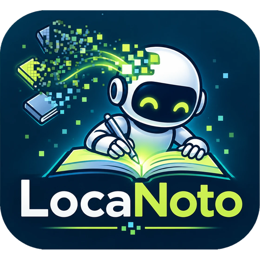

<p align="center"></p>

# LocaNoto

**Local AI knowledge base for companies** · *Lokale KI-Wissensbasis für Unternehmen*

*Deutsch: [README.md](README.md)* · Website: [mw-research.github.io/LocaNoto](https://mw-research.github.io/LocaNoto/en/)

Questions to your own documents, answered with file and page. LocaNoto runs
in your own network; the documents do not leave it.

## Features

- Search in PDF, Word, Markdown, text and scanned pages, answers with sources
- Workspaces with permissions, a private workspace per user
- Tools: database (Microsoft SQL Server), mail and calendar (Exchange, IMAP),
  web search, file creation (Excel, Word, PDF, PowerPoint)
- File store: OpenCloud, oCIS, ownCloud, Nextcloud
- Encrypted storage, sign-in through the company directory (OIDC)
- Web interface and HTTP API (`/api/v1/docs`)
- Runs on Docker or Kubernetes, Postgres with pgvector

## Installation

Requirements: Python 3.8 or newer, Docker or `kubectl`, an OpenAI-compatible
model server. The installer creates keys and certificates, starts every
service, creates the first admin account and checks every part at the end.

**Docker (one machine)** – answer the questions, Enter takes the suggestion:

```bash
curl -fsSLO https://raw.githubusercontent.com/mw-research/LocaNoto/main/deploy/locanoto-setup.py
python3 locanoto-setup.py --en
```

**Kubernetes (no questions)**:

```bash
curl -fsSLO https://raw.githubusercontent.com/mw-research/LocaNoto/main/deploy/locanoto-setup.py
cat > answers.json <<'EOF'
{"target": "kubernetes", "host": "locanoto.example.com",
 "tls": "letsencrypt", "acme_email": "it@example.com",
 "model_url": "https://models.example.com/v1",
 "chat_model": "qwen3.8:27b", "embedding_model": "qwen3-embedding:8b",
 "features": {"websearch": true, "opencloud": false}}
EOF
export LOCANOTO_ADMIN_PASSWORD='...' LOCANOTO_MODEL_API_KEY='...'
python3 locanoto-setup.py --answers answers.json --yes --en
```

Then open `https://<host>`.

```bash
python3 locanoto-setup.py --check      # everything fine?
python3 locanoto-setup.py --upgrade    # new version, same answers
```

`~/.locanoto/secrets.json` holds the installation key – keep an offline
copy. Further answers (own certificate, OpenCloud, network drive for lists,
reranker, …): [deploy/README.md](deploy/README.md).

## Documentation

| Document | Content |
|---|---|
| [HANDBUCH.en.md](HANDBUCH.en.md) | Handbook for users and admins |
| [REFERENCE.en.md](REFERENCE.en.md) | Overview of architecture, features, operation and security |
| [REFERENZ.md](REFERENZ.md) | Complete technical reference (German) |
| [deploy/README.md](deploy/README.md) | Installer |
| [k8s/enterprise/README.md](k8s/enterprise/README.md) | Kubernetes manifests |
| [deploy/demo-erp/README.md](deploy/demo-erp/README.md) | Sample database for demonstrations |
| [connectors/README.md](connectors/README.md) | Data connectors for ERP, MES and databases |
| [.env.example](.env.example) | All settings |

## Layout

| Folder | Content |
|---|---|
| `/` | the application: `server.py` (web UI and API), `worker.py`, the modules and the runs an installation starts (`ingest.py`, `abgleich.py`, `sicherung.py`, `einrichten.py`, …) |
| `scripts/` | tools for running it by hand: create users and tokens, diagnostics, moving, load test |
| `tests/` | self-test (`selftest.py`, parts in `selftest_parts/`) and the checks `test_*.py` |
| `web_templates/`, `web_static/` | pages and styling of the web UI |
| `connectors/` | interface and SQL connector for data connectors |
| `deploy/` | installer and setup helpers |
| `k8s/` | Kubernetes manifests, `k8s/enterprise/` for several instances with Postgres |

## Tests

```bash
python tests/selftest.py
python tests/test_api.py
```

The other `tests/test_*.py` run the same way; `test_multipod.py`,
`test_migration.py` and `test_reembed.py` need a Postgres server with
pgvector in `SELFTEST_DATABASE`.

## Former edition

The former edition (images `schlank` and `voll`) is on branch
[`legacy`](https://github.com/mw-research/LocaNoto/tree/legacy) and is no
longer developed.

## Project

Developed within the project **DIG:IT-KMU** at the Institute for Digital
Engineering (IDEE) of the Technical University of Applied Sciences
Würzburg-Schweinfurt (THWS). Funded under EFRE Bavaria 2021–2027 by the
Bavarian State Ministry of Economic Affairs, Regional Development and Energy,
co-financed by the European Union. https://digit.kmu.bayern

## Licence

[GNU Affero General Public License v3](LICENSE). Licences of the packages
used: [LIZENZEN.md](LIZENZEN.md).

Copyright © 2026 Markus Wilhelm (mw-research)
