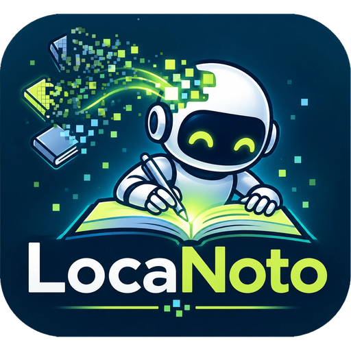

<p align="center"></p>

# LocaNoto

*English: [README.en.md](README.en.md)*

Fragen an die eigenen Dokumente, beantwortet mit Datei und Seite. LocaNoto
läuft im eigenen Netz; die Dokumente verlassen es nicht.

## Funktionen

- Suche in PDF, Word, Markdown, Text und gescannten Seiten, Antwort mit Quellenangabe
- Arbeitsbereiche mit Zugriffsrechten, privater Bereich je Nutzer
- Werkzeuge: Datenbank (Microsoft SQL Server), E-Mail und Kalender (Exchange, IMAP),
  Websuche, Dateien erstellen (Excel, Word, PDF, PowerPoint)
- Dateiablage: OpenCloud, oCIS, ownCloud, Nextcloud
- Verschlüsselte Ablage, Anmeldung über das Firmenverzeichnis (OIDC)
- Web-Oberfläche und HTTP-Schnittstelle (`/api/v1/docs`)
- Betrieb mit Docker oder Kubernetes, Postgres mit pgvector

## Installation

Voraussetzungen: Python 3.8 oder neuer, Docker oder `kubectl`, ein
OpenAI-kompatibler Modellserver. Der Installer erzeugt Schlüssel und
Zertifikate, startet alle Dienste, legt das erste Admin-Konto an und prüft
am Ende jeden Teil.

**Docker (ein Rechner)** – Fragen beantworten, Enter übernimmt den Vorschlag:

```bash
curl -fsSLO https://raw.githubusercontent.com/mw-research/LocaNoto/main/deploy/locanoto-setup.py
python3 locanoto-setup.py
```

**Kubernetes (ohne Fragen)**:

```bash
curl -fsSLO https://raw.githubusercontent.com/mw-research/LocaNoto/main/deploy/locanoto-setup.py
cat > answers.json <<'EOF'
{"target": "kubernetes", "host": "locanoto.example.com",
 "tls": "letsencrypt", "acme_email": "it@example.com",
 "model_url": "https://models.example.com/v1",
 "chat_model": "qwen3.8:27b", "embedding_model": "qwen3-embedding:8b",
 "features": {"websearch": true, "opencloud": false}}
EOF
export LOCANOTO_ADMIN_PASSWORD='...' LOCANOTO_MODEL_API_KEY='...'
python3 locanoto-setup.py --answers answers.json --yes
```

Danach `https://<host>` öffnen.

```bash
python3 locanoto-setup.py --check      # alles in Ordnung?
python3 locanoto-setup.py --upgrade    # neue Version, gleiche Antworten
```

`~/.locanoto/secrets.json` enthält den Installationsschlüssel – eine Kopie
offline aufbewahren. Weitere Antworten (eigenes Zertifikat, OpenCloud,
Netzlaufwerk für Listen, Reranker, …): [deploy/README.md](deploy/README.md).

## Dokumentation

| Dokument | Inhalt |
|---|---|
| [HANDBUCH.md](HANDBUCH.md) | Bedienung für Nutzer und Admins |
| [REFERENZ.md](REFERENZ.md) | Technische Referenz: Aufbau, Konfiguration, Betrieb, Sicherheit |
| [deploy/README.md](deploy/README.md) | Installer |
| [k8s/enterprise/README.md](k8s/enterprise/README.md) | Kubernetes-Manifeste |
| [deploy/demo-erp/README.md](deploy/demo-erp/README.md) | Beispieldatenbank für Vorführungen |
| [.env.example](.env.example) | Alle Einstellungen |

## Tests

```bash
python selbsttest.py
python test_api.py
```

## Frühere Ausgabe

Die frühere Ausgabe (Abbilder `schlank` und `voll`) liegt im Branch
[`legacy`](https://github.com/mw-research/LocaNoto/tree/legacy) und wird nicht
weiterentwickelt.

## Projekt

Entstanden im Projekt **DIG:IT-KMU** am Institut für Digital Engineering (IDEE)
der Technischen Hochschule Würzburg-Schweinfurt (THWS). Gefördert im Rahmen des
EFRE Bayern 2021–2027 durch das Bayerische Staatsministerium für Wirtschaft,
Landesentwicklung und Energie, kofinanziert von der Europäischen Union.
https://digit.kmu.bayern

## Lizenz

[GNU Affero General Public License v3](LICENSE). Lizenzen der verwendeten
Pakete: [LIZENZEN.md](LIZENZEN.md).

Copyright © 2026 Markus Wilhelm (mw-research)
